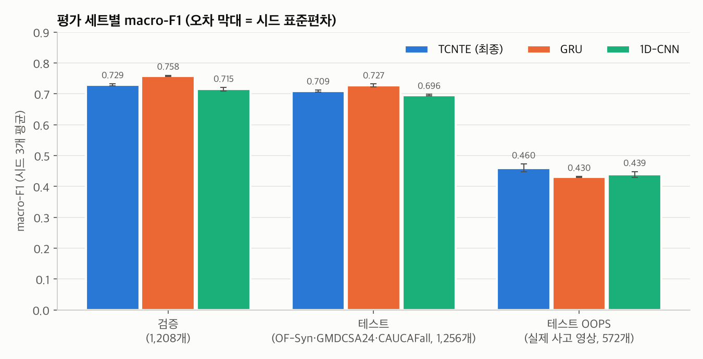
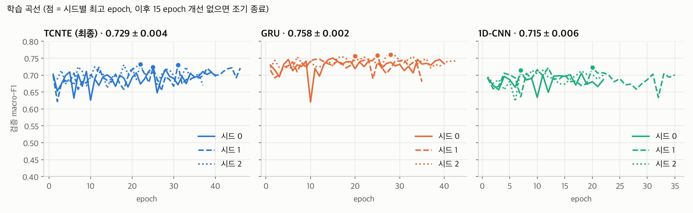
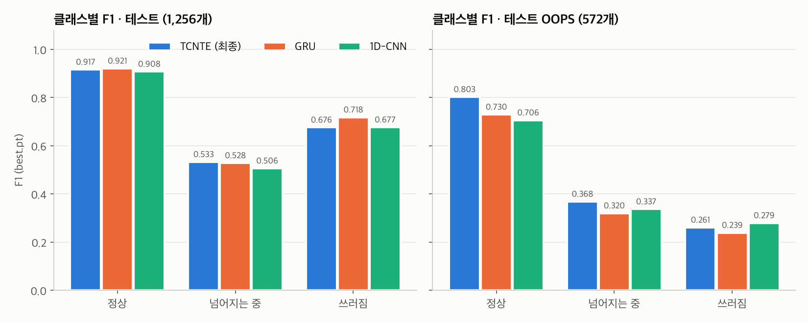
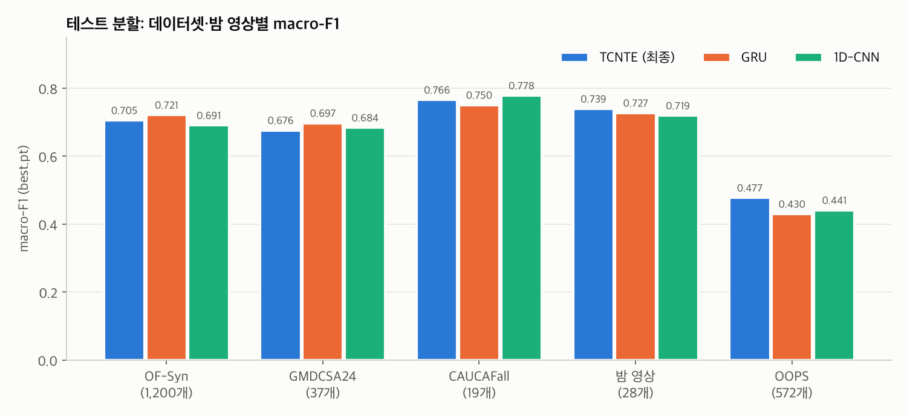
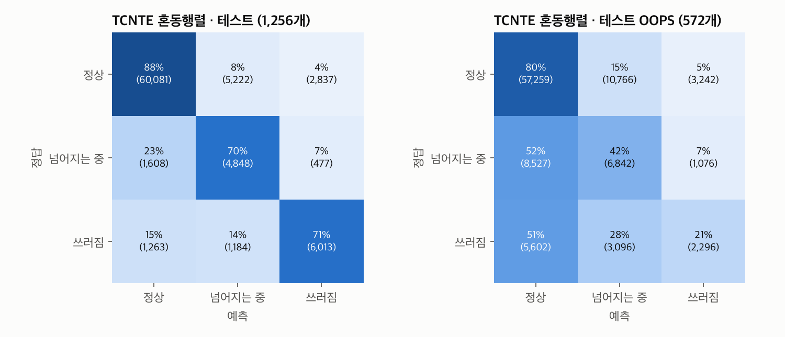

# 분류 모델 학습 보고서 (학습팀)

CCTV 낙상 감지 프로젝트(제안서 최종 v3)에서 학습팀이 만든 **분류 모델**의 학습 방법과 성능을 정리한다.
학습된 모델을 바로 돌려 보는 방법은 [RUN_MODEL.md](RUN_MODEL.md)에 있다.

## 1. 요약

| 항목 | 내용 |
|---|---|
| 학습한 것 | 분류 모델 하나: 최근 2초(30프레임)의 관절 특징을 보고 매 프레임 **정상 / 넘어지는 중 / 쓰러짐** 확률을 낸다 |
| 학습하지 않은 것 | 관절 추출 YOLO26n-pose(사전학습 그대로), 추적 ByteTrack(기본 설정), 판정 로직(상태 머신, 구현팀) |
| 비교한 모델 | TCNTE(메인), GRU, 1D-CNN. 각각 시드 3개, 총 9번 학습 |
| **최종 모델** | **TCNTE** `out/runs/e2_tcnte/best.pt` (파라미터 20,891개) |
| 최종 성능 (테스트) | macro-F1 **0.709 ± 0.003** (1,256개 영상), 처음 보는 실제 사고 영상(OOPS) **0.460 ± 0.013** |



## 2. 전체 흐름

```
영상 ─▶ ① 관절 추출 ─▶ 피험자 선택 ─▶ ② 특징 55개 ─▶ ③ 30프레임 창 ─▶ ④ 분류 모델 학습 (+⑤ 증강) ─▶ 평가
        YOLO26n-pose     끊긴 추적 합치기    엉덩이 중심 정규화   프레임별 정답      TCNTE / GRU / 1D-CNN
        + ByteTrack      주인공 1명 선택     과거 프레임만 사용                     가중 Focal Loss
        (학습 안 함)
```

| 파일 | 제안서 | 역할 |
|---|---|---|
| `download_data.py` | 5장 | OmniFall 영상·라벨, 공식 분할(`split.json`), 밤 영상 목록 |
| `extract_pose.py` | 4.3 ① | 15fps로 맞춰 영상 속 모든 사람의 관절 17개와 추적 ID 저장 |
| `select_subject.py` | 4.3 ① | 끊긴 추적 합치기, 라벨을 붙일 피험자 1명 선택 |
| `features.py` | 4.3 ② | 정규화와 55차원 특징. 학습과 실시간이 같은 코드를 쓴다 |
| `dataset.py` | 4.3 ③ | 구간 라벨 → 프레임별 정답, 30프레임 창 |
| `models.py` | 4.3 ④ | TCNTE, GRU, 1D-CNN |
| `augment.py` | 4.3 ⑤ | 좌우 반전, 좌표 흔들기, 속도 변화, 관절 지우기 |
| `train.py` | 4.3 ④ | 학습 (시드 3개, 조기 종료) |
| `evaluate.py` | 6장 | 실시간 방식 프레임별 평가 |
| `infer.py` | 4.3 ⑧ | 구현팀용 `StreamClassifier` |
| `demo.py` | 7장 | 영상·웹캠 데모 |
| `tests/test_pipeline.py` | | 가짜 관절 데이터로 각 단계 검증 (29개 통과) |

## 3. 데이터

OmniFall 통합 라벨과 **공식 분할**(처음 보는 피험자로 평가)을 썼다.

| 데이터셋 | 종류 | 학습 | 검증 | 테스트 |
|---|---|---|---|---|
| OF-Syn | 합성 영상 | 9,282 / 9,600 | 1,152 / 1,200 | 1,200 / 1,200 |
| GMDCSA24 | 실제 촬영 (방 안, 낮·밤) | 70 / 75 | 47 / 48 | 37 / 37 |
| CAUCAFall | 실제 촬영 (실험실, 낮·밤) | 66 / 69 | 9 / 9 | 19 / 19 |
| OOPS (OF-ItW) | 인터넷 실제 사고 영상 | – | – | 572 / 572 |
| **합계** | | **9,418개 영상, 창 126,529개** | **1,208개, 83,881프레임** | **1,828개** |

표의 숫자는 "사용한 영상 / 라벨 있는 영상"이다.
- 학습·검증에서는 피험자를 믿을 수 없는 영상을 뺐다. 주인공 불명(ambiguous) 268개, 사람이 잡힌 프레임 50% 미만(low_coverage) 106개가 빠졌다.
- 테스트에서는 실시간 사용과 같게 하나도 빼지 않았다.

**정답 (프레임별 3클래스)**

| OmniFall 라벨 | 우리 클래스 |
|---|---|
| fall | 1 넘어지는 중 |
| fallen | 2 쓰러짐 |
| lying (넘어지지 않고 누움) | 제외 (손실·점수에서 뺌) |
| 그 밖의 일상 동작 (walk, sit, lie_down 등) | 0 정상 |

학습 프레임의 클래스 비율은 정상 83% (2,559,852), 넘어지는 중 10% (311,157), 쓰러짐 7% (228,627)로 크게 치우쳐 있다.

## 4. 입력 특징 (프레임당 55개)

| 번호 | 특징 | 계산 |
|---|---|---|
| 0~50 | 관절 17개 × (x, y, 신뢰도) | 엉덩이 중심을 빼고 max(몸통 길이 × 2.5, 가장 먼 관절 거리)로 나눔 |
| 51 | 몸통 각도 | 서 있으면 0, 누우면 1 |
| 52 | 머리 세로 속도 | 아래로 움직이면 +, ±3에서 자름 |
| 53 | 박스 가로/세로 비율 | log2(w/h), 누우면 + |
| 54 | 박스 중심 세로 속도 | 52번과 같은 단위 |

- 신뢰도 0.3 미만 관절과 사람을 못 잡은 프레임은 직전 값을 유지하고 신뢰도를 0으로 둔다.
- 모든 특징은 과거 프레임만 쓴다. 그래서 실시간에서도 학습 때와 같은 값이 나온다.

## 5. 모델

세 모델 모두 입력 (30프레임, 55) → 출력 (30프레임, 3)이다. 프레임 t의 출력은 t 이전만 본다(미래 차단).
실시간에서는 마지막 프레임의 출력을 쓴다.

| 모델 | 구조 | 파라미터 | epoch당 학습 시간 |
|---|---|---|---|
| **TCNTE** (메인) | 인과 TCN 3블록(필터 8·16·32, 커널 5, dilation 1·2·4) + Transformer 인코더(헤드 4, FF 32, 미래 차단 마스크, 위치 임베딩) | **20,891** | 91초 |
| GRU | GRU 2층 (은닉 128) | 170,499 | 54초 |
| 1D-CNN | 인과 1D 합성곱 3층 (채널 64, 커널 5) | 58,947 | 170초 |

시간은 맥북 CPU 1스레드 기준이다. 모델이 작아 스레드를 늘리면 오히려 느려졌다.

## 6. 학습 설정

| 항목 | 값 |
|---|---|
| 손실 | 가중 Focal Loss (γ = 3). 제외 프레임(-1)은 손실에서 뺌 |
| 클래스 가중치 | 정상 0.40, 넘어지는 중 3.32, 쓰러짐 4.52 (프레임 수의 역수, 최대 30) |
| 최적화 | Adam, lr 1e-3, 배치 64 |
| epoch | 최대 100. 검증 macro-F1이 15 epoch 동안 오르지 않으면 조기 종료 |
| 모델 선택 | 검증 세트를 실시간 방식으로 예측한 프레임별 macro-F1이 가장 높은 epoch |
| 실제 영상 비중 | 실제 촬영 창을 반복 추출해 한 epoch의 약 20%가 되게 함 (원래 약 3%) |
| 증강 | 좌우 반전, 좌표 흔들기, 속도 0.8~1.2배, 관절 1~4개 지우기 |
| 반복 | 시드 0·1·2. 검증 점수가 가장 높은 시드를 `best.pt`로 |
| 창 | 30프레임(2초), 5프레임 간격. 앞이 모자라면 0으로 채우고 정답은 제외 |

### 학습 곡선



| 모델 | 시드 0 | 시드 1 | 시드 2 | 평균 ± 표준편차 | best.pt |
|---|---|---|---|---|---|
| TCNTE | 0.724 (epoch 25) | 0.731 (31) | **0.732 (22)** | 0.729 ± 0.004 | 시드 2 |
| GRU | 0.759 (25) | 0.756 (20) | **0.761 (28)** | 0.758 ± 0.002 | 시드 2 |
| 1D-CNN | 0.708 (7) | **0.722 (20)** | 0.715 (7) | 0.715 ± 0.006 | 시드 1 |

검증 macro-F1이다. 괄호는 최고 점수가 나온 epoch이다. 세 모델 모두 20~30 epoch 근처에서 최고점에 이르고, 시드 사이 차이는 0.01 안쪽이다.

## 7. 성능

모든 평가는 **실시간 방식**이다. 영상을 처음부터 한 프레임씩 넣고, 그 프레임까지의 최근 30프레임만으로 판단한다.
점수는 프레임 단위이고, 제외 프레임은 뺐다. 테스트 분할은 모델을 정한 뒤 한 번만 썼다.

### 7.1 전체 (macro-F1, 시드 3개 평균 ± 표준편차)

| 모델 | 검증 (1,208개) | 테스트 (1,256개) | 테스트 OOPS (572개) |
|---|---|---|---|
| **TCNTE** (최종) | 0.729 ± 0.004 | 0.709 ± 0.003 | **0.460 ± 0.013** |
| GRU | **0.758 ± 0.002** | **0.727 ± 0.004** | 0.430 ± 0.002 |
| 1D-CNN | 0.715 ± 0.006 | 0.696 ± 0.002 | 0.439 ± 0.010 |

### 7.2 클래스별 F1 (best.pt)



| 모델 | 평가 | 정상 | 넘어지는 중 | 쓰러짐 | macro-F1 | 정확도 |
|---|---|---|---|---|---|---|
| TCNTE | 검증 | 0.934 | 0.528 | 0.735 | 0.732 | 0.877 |
| | 테스트 | 0.917 | **0.533** | 0.676 | 0.709 | 0.849 |
| | OOPS | **0.803** | **0.368** | 0.261 | **0.477** | 0.673 |
| GRU | 검증 | 0.944 | 0.550 | 0.788 | 0.761 | 0.893 |
| | 테스트 | 0.921 | 0.528 | **0.718** | **0.723** | 0.857 |
| | OOPS | 0.730 | 0.320 | 0.239 | 0.430 | 0.587 |
| 1D-CNN | 검증 | 0.928 | 0.501 | 0.739 | 0.722 | 0.867 |
| | 테스트 | 0.908 | 0.506 | 0.677 | 0.697 | 0.837 |
| | OOPS | 0.706 | 0.337 | **0.279** | 0.441 | 0.568 |

정확도는 정상 프레임이 대부분이라 높게 나온다. 그래서 모델 비교는 macro-F1로 한다.

### 7.3 데이터셋·밤 영상별 (테스트, best.pt macro-F1)



| 모델 | OF-Syn (1,200개) | GMDCSA24 (37개) | CAUCAFall (19개) | 낮 (1,228개) | 밤 (28개) | OOPS (572개) |
|---|---|---|---|---|---|---|
| **TCNTE** | 0.705 | 0.676 | 0.766 | 0.705 | **0.739** | **0.477** |
| GRU | **0.721** | **0.697** | 0.750 | **0.721** | 0.727 | 0.430 |
| 1D-CNN | 0.691 | 0.684 | **0.778** | 0.694 | 0.719 | 0.441 |

### 7.4 TCNTE 혼동행렬



행은 정답, 열은 예측이다. 비율은 정답 행 기준이다.
- **테스트:** 넘어지는 중과 쓰러짐의 약 70%를 맞힌다. 정상 프레임의 8%는 넘어지는 중으로, 4%는 쓰러짐으로 잘못 본다.
- **OOPS:** 쓰러짐 프레임의 51%를 정상으로 본다. 쓰러진 뒤 사람이 잘 안 잡히는 것이 큰 원인이다.

### 7.5 사람을 못 잡은 비율

| 평가 | 피험자를 못 잡은 프레임 | 쓰러짐 구간에서 피험자가 잡힌 비율 |
|---|---|---|
| 테스트 (OF-Syn·GMDCSA24·CAUCAFall) | 2.2% | 78~99% |
| 테스트 OOPS | **39.2%** | **55.8%** |

OOPS 572개 중 181개(31.6%)는 사람이 잡힌 프레임이 절반 미만이다. 이 영상들을 빼면 TCNTE는 0.503 ± 0.008이다.

### 7.6 E1: GMDCSA24만으로 학습 (참고)

파이프라인이 끝까지 도는지 확인한 첫 실험이다. 학습 영상이 70개뿐이라 모델 비교 근거로는 쓰지 않는다.

| 모델 | 검증 macro-F1 (47개 영상) |
|---|---|
| GRU | 0.784 ± 0.006 |
| TCNTE | 0.748 ± 0.013 |
| 1D-CNN | 0.748 ± 0.008 |

## 8. 최종 모델로 TCNTE를 고른 이유

1. **제안서의 메인 모델이다.**
2. **가장 가볍다.** 파라미터가 GRU의 1/8이다(20,891 vs 170,499). 여러 사람을 동시에 실시간으로 판정하기에 유리하다.
3. **처음 보는 실제 사고 영상(OOPS)에서 가장 높다.** 0.460으로 GRU(0.430)보다 0.03 높고, 정상과 넘어지는 중 F1도 가장 높다.
4. **GRU와의 차이가 크지 않다.** 전체 테스트에서 GRU가 0.018 높지만, 차이는 대부분 합성 영상(OF-Syn)과 쓰러짐 F1에서 난다. 실제 촬영 데이터셋은 데이터셋마다 1등이 다르다.

## 9. 한계와 구현팀 참고 사항

- **넘어지는 중이 가장 약하다** (테스트 F1 약 0.53). 구간이 1~2초로 짧고 시작과 끝 경계가 애매하다. 판정 로직에서 여러 프레임을 묶어 판단하는 것이 좋다.
- **촬영 조건이 다르면 크게 떨어진다.** 휴대폰 촬영, 카메라 움직임, 화면 밖으로 나가는 경우(OOPS)에는 테스트보다 0.25 낮다. 고정 CCTV에서 전신이 보이는 조건을 권장한다.
- **누워 있는 상태(lying)는 학습에서 뺐다.** 넘어지지 않고 그냥 누운 사람에 대한 출력은 학습되지 않았다. 판정 로직이 "넘어지는 중"을 거쳤는지로 구분해야 한다.
- **학습 데이터의 약 97%가 합성 영상이다.** 실제 영상을 반복해 20%로 맞췄지만 같은 영상이 여러 번 쓰였다.
- **실제 영상 테스트가 적다.** GMDCSA24 37개, CAUCAFall 19개, 밤 28개라 데이터셋별 순위는 단정하기 어렵다.
- **영상 단위 평가는 아직 없다.** 영상 단위 민감도·특이도, 시간당 오경보는 판정 로직(상태 머신)이 있어야 계산할 수 있다.
- **입력 조건을 맞춰야 한다.** 포즈 모델(YOLO26n-pose), 추적 설정(`bytetrack.yaml` 기본값), 15fps가 학습 때와 다르면 입력 분포가 달라진다.

## 10. 제안서에 없어 정한 것

- **트랙 합치기 간격:** 3초로 했다(제안서 1초). 넘어지는 동안 1~2초 놓쳤다가 다시 잡히는 영상이 많았다. 3초로 늘리자 GMDCSA24 검증의 쓰러짐 구간 검출률이 60%에서 68%로 올랐다.
- **피험자 후보:** 움직이는 사람이 있으면 제자리 검출(박스 중심 이동이 박스 긴 변의 15% 미만)은 후보에서 뺐다. 벽에 걸린 옷이 사람으로 잡혔기 때문이다.
- **추적 설정:** 기본값 그대로다. 임계값을 낮추자 영상당 트랙이 1.8개에서 3.3개로 늘어 주인공 불명이 많아졌다.
- **정답을 모르는 프레임:** 어떤 라벨 구간에도 속하지 않는 프레임은 제외했다.
- **TCNTE 위치 임베딩:** 30 × 32 위치 임베딩을 넣었다. 그래서 파라미터가 20,891개다(제안서 표기 약 2.2만).
- **macro-F1 계산:** 정답에 나온 클래스만 평균한다.
- **테스트 분할 영상:** 사람을 잘 못 잡은 영상도 빼지 않는다. 학습·검증은 믿을 수 있는 영상만 쓴다.

## 11. 다시 만들기

```bash
pip install -r requirements.txt
python -m unittest discover -s tests

python download_data.py labels GMDCSA24 of-syn caucafall night
python extract_pose.py --dataset GMDCSA24 --device mps        # of-syn, caucafall도 같은 방식 (--shard 0/3 등으로 나눠 돌릴 수 있음)
python dataset.py --datasets of-syn GMDCSA24 caucafall
for m in tcnte gru cnn; do python train.py --datasets of-syn GMDCSA24 caucafall --model $m --out out/runs/e2_$m; done
for m in tcnte gru cnn; do python evaluate.py --run out/runs/e2_$m --datasets of-syn GMDCSA24 caucafall --split val; done

# 테스트 (모델 확정 뒤 한 번)
for m in tcnte gru cnn; do python evaluate.py --run out/runs/e2_$m --datasets of-syn GMDCSA24 caucafall --split test; done

# OOPS: 공식 주소가 404라 Hugging Face 사본(pengxiang/oops)의 video_and_anns.tar.gz를 받아서
omnifall prepare OOPS --yes --archive <video_and_anns.tar.gz> --video-dir data/omnifall/OOPS/video
python extract_pose.py --dataset OOPS --device mps && python dataset.py --datasets OOPS
for m in tcnte gru cnn; do python evaluate.py --run out/runs/e2_$m --datasets OOPS --split test --tag oops; done

python docs/make_figures.py                                      # 이 문서의 그래프
```
